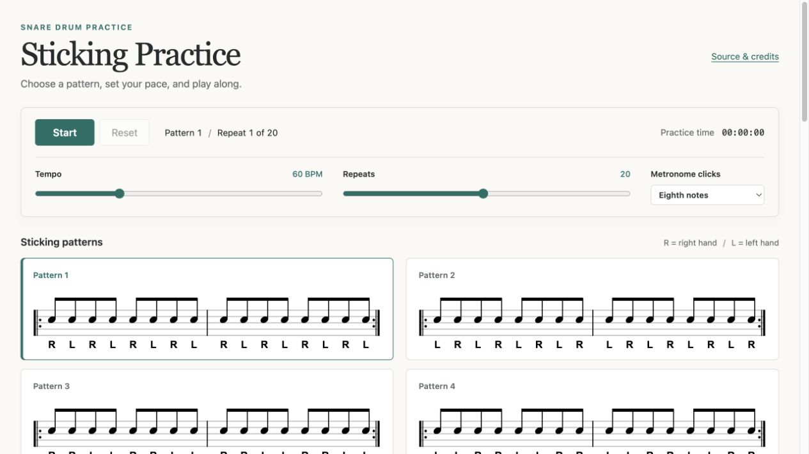

# Sticking Practice

Practice 24 snare drum sticking patterns with a metronome and notation that
follows along. Set your tempo and repeat count, then work through the patterns
at your own pace.

The sticking patterns come from
[*Stick Control for the Snare Drummer*](https://www.stonepercussionbooks.com/stick-control.html)
by George Lawrence Stone.

[Open Sticking Practice](https://bartgalvin.github.io/stick-control/)



## Practice

- Click anywhere on a pattern to select it.
- Set the tempo from 20 to 160 BPM and the repeats from 1 to 40.
- Choose sixteenth, eighth, or quarter-note metronome clicks.
- Click **Start** to begin. **Pause** stops playback; **Resume** continues from
  your position. **Reset** returns to the first pattern and clears practice time.

R means right hand; L means left hand. Each pattern contains two bars of eighth
notes, and BPM counts quarter-note beats. After the chosen number of repeats,
playback moves to the next pattern. The sequence loops after pattern 24.

Tempo and click settings can change during practice. Switching to another
browser tab pauses playback. Click **Resume** when you're ready to continue.

## Run locally

From this project directory, start a local web server:

```sh
python3 -m http.server 8000
```

Open [localhost:8000](http://localhost:8000) in your browser. The app runs
entirely in the browser, with no package installation or build step. Its assets
are bundled locally.

## Credits and license

Notation uses [VexFlow](https://github.com/0xfe/vexflow), bundled at version
1.2.89. The audio scheduler is adapted from Chris Wilson's
[Web Audio Metronome](https://github.com/cwilso/metronome).
Their license notices are in [licenses](licenses/).

The app's code is released under the [MIT license](LICENSE).
